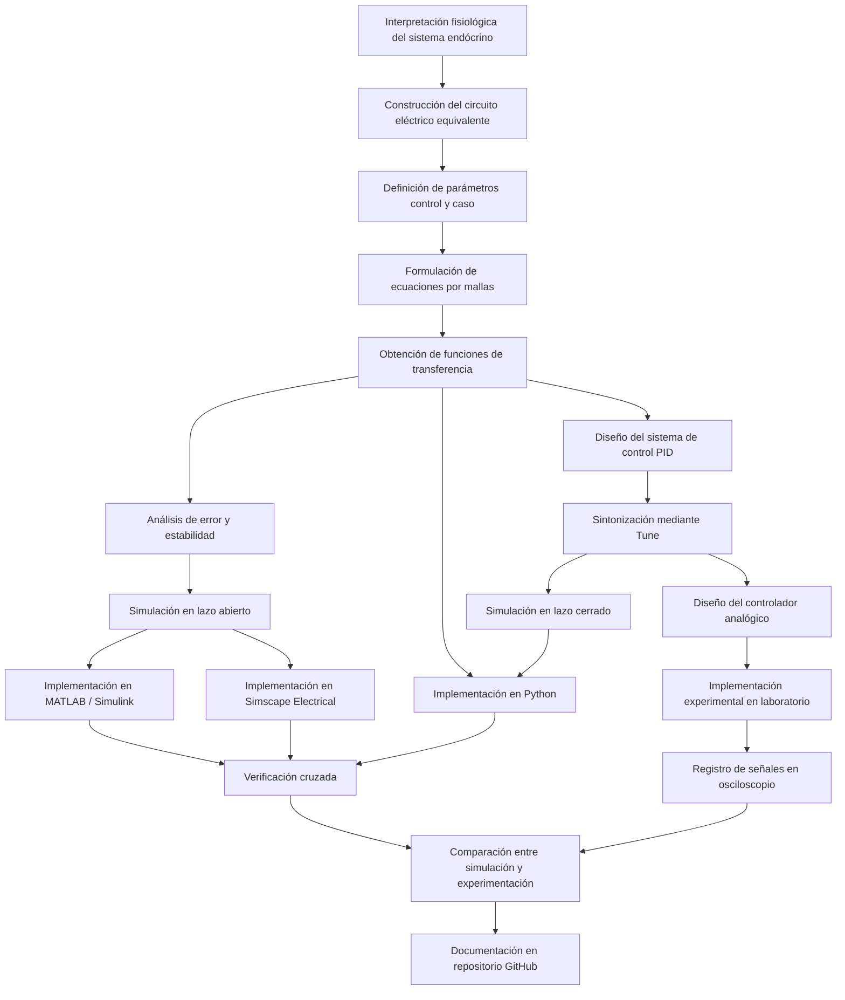

[](https://matlab.mathworks.com/open/github/v1?repo=soriano-23212231/MSFP4)

# Práctica 4 — Modelado y control del sistema endócrino

Repositorio académico de la asignatura **Modelado de Sistemas Fisiológicos**, correspondiente al programa de **Ingeniería Biomédica** del Tecnológico Nacional de México / Instituto Tecnológico de Tijuana. Esta práctica integra el modelado de sistemas fisiológicos mediante analogías eléctricas, formulación matemática por mallas, análisis temporal y de estabilidad, diseño de controladores clásicos (PID), simulación computacional (*in silico*) y verificación experimental.

El caso de estudio representa un modelo fenomenológico simplificado del sistema endócrino mediante un circuito eléctrico equivalente de segundo orden. Se busca modelar, simular y controlar la dinámica de la señal hormonal, comparando una condición de referencia (control) con una condición alterada (caso), y evaluando una estrategia de control orientada a reducir las diferencias entre ambas respuestas.

**Docente:** Dr. Paul Antonio Valle Trujillo  
**Correo:** paul.valle@tectijuana.edu.mx  
**Departamento:** Ingeniería Eléctrica y Electrónica  
**Institución:** Tecnológico Nacional de México / Instituto Tecnológico de Tijuana  
**Asignatura:** Modelado de Sistemas Fisiológicos  
**Programa:** Ingeniería Biomédica  
**Estudiante:** Judith Valeria Soriano Angeles · 23212231 · l23212231@tectijuana.edu.mx

**Repositorio de la asignatura:** https://github.com/DrPaulValle/MSF-IBF1020  
**Sede:** Blvd. Alberto Limón Padilla s/n, Tijuana, C. P. 22454, B. C., México.

---

<a id="contenido"></a>
## Contenido

1. [Resumen](#resumen)
2. [Competencia y objetivos](#objetivos)
3. [Relación con el temario](#temario)
4. [Modelo fisiológico y analogía eléctrica](#analogia)
5. [Formulación matemática](#modelo)
6. [Análisis temporal y de estabilidad](#analisis)
7. [Condiciones de simulación y parámetros](#senales)
8. [Implementación en MATLAB, Simulink y Simscape Electrical](#matlab)
9. [Control en lazo cerrado y sintonización PID](#pid)
10. [Reproducción en Python](#python)
11. [Controlador analógico y laboratorio](#laboratorio)
12. [Resultados y verificación cruzada](#resultados)
13. [Flujo de trabajo](#flujo)
14. [Actividades de la estudiante](#actividades)
15. [Estructura del repositorio](#estructura)
16. [Requisitos](#requisitos)
17. [Reproducibilidad y entregables](#reproducibilidad)
18. [Referencias](#referencias)

---

<a id="resumen"></a>
## Resumen

La práctica tiene como propósito modelar, analizar, simular y controlar un sistema fisiológico mediante una analogía eléctrica de segundo orden. El sistema endócrino se representa de manera simplificada a partir de los procesos de secreción, transporte, almacenamiento, utilización y eliminación de señales hormonales. Estos procesos se describen mediante un circuito eléctrico equivalente constituido por una resistencia de entrada ($R_1$), un capacitor ($C$), un inductor ($L$) y una resistencia de salida ($R_2$).

Se estudian dos condiciones del sistema: una condición de referencia (control) y una condición alterada (caso), diferenciadas mediante la modificación simultánea de la capacitancia $C$ y la resistencia $R_2$. A partir de las leyes de Kirchhoff por mallas y la transformada de Laplace se obtienen las funciones de transferencia del sistema, se analiza su estabilidad mediante la ubicación de sus polos y se determina el error en estado estacionario ante una entrada escalón unitario.

Posteriormente, se implementan las representaciones matemáticas y circuitales en MATLAB/Simulink y Simscape Electrical. La respuesta del control se utiliza como referencia para diseñar un sistema de retroalimentación con un controlador PID, cuyas ganancias se determinan mediante la herramienta Tune. Los resultados se reproducen mediante Python y se realiza una verificación experimental de los circuitos en el Laboratorio de Electrónica, incluyendo la implementación analógica del controlador mediante amplificadores operacionales.

Esta práctica utiliza una **analogía fenomenológica con fines académicos**. El circuito no representa un eje hormonal específico y los valores de sus componentes eléctricos no corresponden directamente a magnitudes fisiológicas medidas experimentalmente.

**Palabras clave:** Sistema endócrino; analogía eléctrica; circuito RLC; función de transferencia; controlador PID; MATLAB; Simulink; Simscape Electrical; Python; instrumentación electrónica.

[Volver al contenido](#contenido)

---

<a id="objetivos"></a>
## Competencia y objetivos

### Competencia a desarrollar

Modeliza sistemas fisiológicos mediante analogías eléctricas, ecuaciones diferenciales y funciones de transferencia para analizar su comportamiento dinámico y diseña estrategias de control mediante técnicas de control clásico. En particular, durante la práctica se interpreta una descripción simplificada de los procesos de secreción, transporte, almacenamiento y respuesta hormonal para proponer un circuito eléctrico equivalente de segundo orden, se compara una condición de referencia (control) con una condición alterada (caso), se diseña un controlador PID y se contrastan los resultados obtenidos mediante modelado analítico, simulación computacional y experimentación en el Laboratorio de Electrónica.

### Objetivo general

Modelar, simular y controlar la dinámica de un sistema endócrino mediante su representación eléctrica equivalente, formulación matemática, análisis de estabilidad y diseño de un controlador PID, verificando la consistencia de los resultados entre plataformas computacionales y montaje experimental.

### Objetivos específicos

1. Proponer el circuito eléctrico equivalente del sistema endócrino identificando las correspondencias fisiológicas, variables de entrada/salida, flujos y parámetros para las condiciones control y caso.
2. Formular el modelo mediante ecuaciones integro-diferenciales de malla y obtener las funciones de transferencia $G_{\text{control}}(s)$ y $G_{\text{caso}}(s)$ mediante transformada de Laplace.
3. Evaluar la estabilidad en lazo abierto y el error en estado estacionario ante una entrada escalón unitario mediante la ubicación de los polos en el plano complejo.
4. Implementar y contrastar el comportamiento dinámico del sistema en MATLAB/Simulink (ecuaciones y función de transferencia) y Simscape Electrical.
5. Diseñar y sintonizar un controlador PID en lazo cerrado tomando la respuesta del control como referencia para reducir el error de la condición caso.
6. Reproducir los resultados de simulación en Python (Visual Studio Code) y calcular los componentes comerciales para sintetizar el controlador PID analógico con amplificadores operacionales.
7. Construir y evaluar experimentalmente los circuitos en el Laboratorio de Electrónica, contrastando las mediciones del osciloscopio con los resultados teóricos y simulados.

[Volver al contenido](#contenido)

---

<a id="temario"></a>
## Relación con el temario

La práctica integra contenidos correspondientes a las unidades fundamentales de la asignatura **Modelado de Sistemas Fisiológicos (IBF-1020)**:

| Unidad | Área | Contenidos aplicados |
|---|---|---|
| I | Sistemas de control retroalimentados | Diagramas de bloques, señales de referencia, error en estado estacionario, retroalimentación negativa y controladores PID |
| II | Modelado matemático | Analogías entre sistemas físicos y eléctricos, leyes de Kirchhoff, ecuaciones integro-diferenciales y funciones de transferencia |
| III | Controladores | Diseño, sintonización e implementación analógica de controladores clásicos, análisis de respuesta transitoria y estado estacionario |

[Volver al contenido](#contenido)

---

<a id="analogia"></a>
## Modelo fisiológico y analogía eléctrica

El sistema endócrino participa en la regulación de diversos procesos fisiológicos mediante la liberación de hormonas producidas por glándulas especializadas. Una vez secretadas, estas moléculas son transportadas mediante la circulación hasta tejidos u órganos diana, donde interactúan con receptores específicos y producen respuestas cuya intensidad y duración dependen de los mecanismos de producción, transporte, distribución, almacenamiento, utilización y eliminación.

Para el desarrollo de la práctica, estos procesos se representan mediante un modelo fenomenológico simplificado de segundo orden. El circuito eléctrico equivalente consta de una fuente de voltaje $V_e(t)$ en serie con una resistencia $R_1$, conectada a un nodo donde convergen en paralelo un capacitor $C$ a tierra y una rama formada por un inductor $L$ en serie con una resistencia $R_2$. La salida $V_s(t)$ se mide en dicho nodo común entre $R_1$, $C$ y $L$.

### Correspondencias fisiológicas y eléctricas

| Variable o proceso fisiológico | Representación eléctrica | Interpretación dentro del modelo |
|---|---|---|
| Estímulo para la secreción hormonal | $V_e(t)$ | Señal de entrada que activa la respuesta del sistema endócrino |
| Flujo de secreción y transporte hormonal | $F_e(t) = i_1(t)$ | Corriente de malla 1 asociada con la transferencia de la señal hormonal desde la fuente hacia el compartimento |
| Pérdidas y oposición durante el transporte | $R_1$ | Representación fenomenológica de procesos que reducen o retardan la transmisión de la señal hormonal |
| Acumulación temporal de hormona | $C$ | Capacidad del compartimento para almacenar temporalmente la señal hormonal antes de su utilización o eliminación |
| Retardo o inercia de la respuesta del tejido diana | $L$ | Representación de la resistencia dinámica del sistema a cambios rápidos en la respuesta hormonal |
| Utilización, disipación o eliminación de la señal | $R_2$ | Oposición efectiva asociada con la utilización o desaparición de la señal hormonal en el compartimento |
| Flujo asociado con la respuesta del tejido diana | $F_s(t) = i_2(t)$ | Corriente de malla 2 correspondiente a la rama que representa la respuesta del órgano diana |
| Nivel hormonal efectivo | $V_s(t)$ | Variable de salida que representa de manera normalizada la señal hormonal disponible en el compartimento |

### Parámetros del circuito equivalente (Control vs. Caso)

Para representar las dos condiciones del sistema endócrino se utilizan los valores comerciales indicados en el instructivo:

| Componente | Control | Caso | Unidad |
|---|---:|---:|---|
| $R_1$ | 1 | 1 | kΩ |
| $L$ | 100 | 100 | mH |
| $C$ | 1 | 1000 | μF |
| $R_2$ | 100 | 1 | kΩ |

La diferencia entre ambas condiciones se establece mediante la modificación simultánea de la capacitancia $C$ y la resistencia $R_2$, permitiendo analizar cómo los cambios en las propiedades de almacenamiento y disipación afectan la dinámica del sistema.

[Volver al contenido](#contenido)

---

<a id="modelo"></a>
## Formulación matemática

La formulación matemática se desarrolla mediante el método de análisis de mallas considerando las corrientes $i_1(t) = F_e(t)$ e $i_2(t) = F_s(t)$ y condiciones iniciales nulas.

### 1. Ecuaciones integro-diferenciales por mallas

Aplicando la ley de voltajes de Kirchhoff en la malla 1 y en la malla 2:

$$V_e(t) = R_1 i_1(t) + \frac{1}{C}\int \left[i_1(t) - i_2(t)\right]dt$$

$$\frac{1}{C}\int \left[i_1(t) - i_2(t)\right]dt = L\frac{di_2(t)}{dt} + R_2 i_2(t)$$

Despejando las corrientes para su implementación en diagramas de bloques:

$$i_1(t) = \frac{1}{R_1}\left[V_e(t) - \frac{1}{C}\int \left(i_1(t) - i_2(t)\right)dt\right]$$

$$i_2(t) = \frac{1}{R_2}\left[\frac{1}{C}\int \left(i_1(t) - i_2(t)\right)dt - L\frac{di_2(t)}{dt}\right]$$

La variable de salida $V_s(t)$ corresponde al voltaje en el nodo de unión, equivalente a la caída de tensión en la rama del tejido diana:

$$V_s(t) = L\frac{di_2(t)}{dt} + R_2 i_2(t)$$

### 2. Función de transferencia

Aplicando la transformada de Laplace con condiciones iniciales nulas:

$$V_e(s) = R_1 I_1(s) + \frac{1}{Cs}\left[I_1(s) - I_2(s)\right]$$

$$\frac{1}{Cs}\left[I_1(s) - I_2(s)\right] = (Ls + R_2)I_2(s)$$

$$V_s(s) = (Ls + R_2)I_2(s)$$

Relacionando $I_1(s)$ en términos de $I_2(s)$ y sustituyendo en la ecuación de entrada se obtiene la función de transferencia general de segundo orden:

$$\boxed{ G(s) = \frac{V_s(s)}{V_e(s)} = \frac{Ls + R_2}{R_1LCs^2 + (L + R_1R_2C)s + (R_1 + R_2)} }$$

### 3. Funciones de transferencia particulares (Control y Caso)

Sustituyendo los valores comerciales correspondientes a cada condición:

- **Condición Control** ($R_1 = 1\,\mathrm{k}\Omega$, $L = 100\,\mathrm{mH}$, $C = 1\,\mu\mathrm{F}$, $R_2 = 100\,\mathrm{k}\Omega$):

$$G_{\text{control}}(s) = \frac{0.1s + 100\,000}{0.0001s^2 + 100.1s + 101\,000}$$

- **Condición Caso** ($R_1 = 1\,\mathrm{k}\Omega$, $L = 100\,\mathrm{mH}$, $C = 1000\,\mu\mathrm{F}$, $R_2 = 1\,\mathrm{k}\Omega$):

$$G_{\text{caso}}(s) = \frac{0.1s + 1000}{0.1s^2 + 1000.1s + 2000}$$

[Volver al contenido](#contenido)

---

<a id="analisis"></a>
## Análisis temporal y de estabilidad

El análisis teórico previo a la simulación permite predecir el comportamiento transitorio y estacionario de ambas condiciones ante una entrada escalón unitario $V_e(s) = \frac{1}{s}$.

### 1. Error en estado estacionario

Aplicando el teorema del valor final:

$$e_{ss} = \lim_{s \to 0} s V_e(s)\left[1 - G(s)\right] = 1 - \frac{R_2}{R_1 + R_2} = \frac{R_1}{R_1 + R_2}$$

- **Control:** $e_{ss,\text{control}} = \frac{1000}{1000 + 100\,000} \approx 0.0099$ ($\approx 0.99\%$), estabilizándose en $V_{s,\text{control}}(\infty) \approx 0.9901\,\mathrm{V}$.
- **Caso:** $e_{ss,\text{caso}} = \frac{1000}{1000 + 1000} = 0.5$ ($50\%$), estabilizándose en $V_{s,\text{caso}}(\infty) = 0.5\,\mathrm{V}$.
- **Diferencia estacionaria entre sistemas:** $e(\infty) = V_{s,\text{control}}(\infty) - V_{s,\text{caso}}(\infty) \approx 0.4901\,\mathrm{V}$.

### 2. Polos y estabilidad en lazo abierto

Resolviendo la ecuación característica $R_1LCs^2 + (L + R_1R_2C)s + (R_1 + R_2) = 0$:

| Condición | Polos calculados ($\lambda_{1,2}$) | Naturaleza y estabilidad |
|---|---|---|
| **Control** | $\lambda_1 = -1010.01$, $\lambda_2 = -999\,989.98$ | Reales negativos distintos: **estable y sobreamortiguado** (transitorio muy rápido) |
| **Caso** | $\lambda_1 = -2.0002$, $\lambda_2 = -9998.99$ | Reales negativos distintos: **estable y sobreamortiguado** (transitorio más lento) |

[Volver al contenido](#contenido)

---

<a id="senales"></a>
## Condiciones de simulación y parámetros

La entrada utilizada durante la práctica corresponde a un escalón unitario $V_e(t) = u(t)$, que representa un estímulo fisiológico sostenido aplicado al sistema endócrino. Las simulaciones se ejecutan en el intervalo temporal:

$$t \in [0, 10]\ \mathrm{s}$$

Para el diseño del sistema de control en lazo cerrado, la respuesta del control se toma como señal de referencia para el caso, definiendo el error de seguimiento como:

$$e(t) = V_{s,\text{control}}(t) - V_{s,\text{caso}}(t)$$

[Volver al contenido](#contenido)

---

<a id="matlab"></a>
## Implementación en MATLAB, Simulink y Simscape Electrical

La implementación computacional comprende tres representaciones equivalentes para las condiciones control y caso:

1. **Modelo de ecuaciones integro-diferenciales:** Diagrama de bloques en Simulink construido a partir de las ecuaciones de malla obtenidas mediante las leyes de Kirchhoff.
2. **Modelo mediante funciones de transferencia:** Bloques directos $G_{\text{control}}(s)$ y $G_{\text{caso}}(s)$.
3. **Circuito eléctrico equivalente en Simscape Electrical:** Construcción física con fuentes, resistores, capacitores e inductores comerciales.

### Cuaderno computacional (`.mlx`)

Permite ejecutar los modelos de Simulink, extraer las señales de control, caso y sistema controlado al *Workspace*, generar gráficas comparativas con identificación de variables y unidades, y exportar las figuras automáticamente en formato PDF.

[Volver al contenido](#contenido)

---

<a id="pid"></a>
## Control en lazo cerrado y sintonización PID

Se implementa un sistema de control con retroalimentación negativa unitaria utilizando $V_{s,\text{control}}(t)$ como referencia y el bloque **PID Controller** actuando sobre la planta del caso:

- **Sintonización:** Mediante la herramienta **Tune** en Simulink se determinan las ganancias $k_P$, $k_I$ y $k_D$ buscando una respuesta estable que reduzca el error estacionario de $0.49\,\mathrm{V}$ y aproxime la curva $V_{s,\text{PID}}(t)$ a $V_{s,\text{control}}(t)$.
- **Análisis en lazo cerrado:** Se comparan las respuestas temporales $V_{s,\text{control}}(t)$, $V_{s,\text{caso}}(t)$ y $V_{s,\text{PID}}(t)$ evaluando el efecto del controlador sobre el régimen transitorio y estacionario.

[Volver al contenido](#contenido)

---

<a id="python"></a>
## Reproducción en Python

Como parte de la verificación cruzada, se desarrolla un script en Python utilizando Visual Studio Code:

- Definición de las funciones de transferencia $G_{\text{control}}(s)$ y $G_{\text{caso}}(s)$.
- Simulación de las respuestas al escalón unitario en el intervalo $t \in [0, 10]\,\mathrm{s}$.
- Incorporación de las ganancias $k_P$, $k_I$ y $k_D$ sintonizadas en Simulink para simular el sistema en lazo cerrado.
- Generación y exportación de figuras comparativas entre MATLAB/Simulink y Python.

[Volver al contenido](#contenido)

---

<a id="laboratorio"></a>
## Controlador analógico y laboratorio

### Diseño del controlador analógico

Las ganancias $k_P$, $k_I$ y $k_D$ obtenidas en Simulink se emplean para calcular los valores de resistencias y capacitores requeridos para implementar el controlador PID mediante amplificadores operacionales, seleccionando valores comerciales y validando previamente su respuesta en **Simscape Electrical** frente al bloque PID ideal.

### Implementación experimental y comparación

1. **Lazo abierto:** Montaje en protoboard de los circuitos control y caso, aplicando una aproximación periódica al escalón unitario con el generador de funciones y capturando $V_e(t)$ y $V_s(t)$ en el osciloscopio.
2. **Lazo cerrado:** Conexión del controlador PID analógico (con alimentación simétrica) al circuito del caso y registro de las señales en el osciloscopio.
3. **Análisis de discrepancias:** Contraste entre simulación y laboratorio considerando tolerancias de componentes, resistencia interna del inductor ($100\,\mathrm{mH}$), resistencia serie equivalente (ESR) del capacitor electrolítico ($1000\,\mu\mathrm{F}$), no idealidades de los amplificadores operacionales, limitaciones de los instrumentos y aproximación experimental del escalón.

[Volver al contenido](#contenido)

---

<a id="resultados"></a>
## Resultados y verificación cruzada

La verificación cruzada contrasta consistentemente las respuestas obtenidas mediante:

1. Ecuaciones integro-diferenciales en Simulink.
2. Funciones de transferencia en Simulink.
3. Circuitos eléctricos equivalentes en Simscape Electrical.
4. Cuaderno computacional de MATLAB.
5. Código desarrollado en Python.
6. Mediciones experimentales del osciloscopio en el Laboratorio de Electrónica.

[Volver al contenido](#contenido)

---

<a id="flujo"></a>
## Flujo de trabajo


[Volver al contenido](#contenido)
---

<a id="actividades"></a>
## Actividades de la estudiante

1. **Interpretación fisiológica y circuito equivalente:** Proponer la topología del sistema endócrino identificando $V_e(t)$, $V_s(t)$, $R_1$, $C$, $L$, $R_2$, corrientes $F_e(t)$ y $F_s(t)$, nodos y referencia para control y caso.
2. **Formulación matemática y función de transferencia:** Aplicar las leyes de Kirchhoff por mallas y la transformada de Laplace para obtener $G_{\text{control}}(s)$ y $G_{\text{caso}}(s)$.
3. **Análisis de error y estabilidad:** Calcular $e_{ss}$ ante escalón unitario, determinar los polos en el plano complejo y elaborar el bosquejo cualitativo previo de las respuestas.
4. **Implementación en MATLAB/Simulink:** Construir los modelos por ecuaciones integro-diferenciales, función de transferencia y circuito en Simscape Electrical, analizando su respuesta en lazo abierto en $t \in [0, 10]\,\mathrm{s}$.
5. **Control en lazo cerrado y sintonización:** Implementar la retroalimentación tomando $V_{s,\text{control}}(t)$ como referencia, sintonizar $k_P$, $k_I$ y $k_D$ con Tune y comparar $V_{s,\text{control}}(t)$, $V_{s,\text{caso}}(t)$ y $V_{s,\text{PID}}(t)$.
6. **Validación computacional (MATLAB y Python):** Desarrollar el cuaderno `.mlx` para exportar figuras en PDF y reproducir las simulaciones en Python mediante Visual Studio Code.
7. **Diseño analógico, experimentación y documentación:** Calcular los componentes comerciales del PID con op-amps, simularlo en Simscape, montar los circuitos en protoboard, capturar resultados en el osciloscopio y documentar el repositorio con `README.md` y `CITATION.cff`.

[Volver al contenido](#contenido)

---

<a id="estructura"></a>
## Estructura del repositorio

```text
.
├── README.md                          # Reporte técnico de la práctica
├── CITATION.cff                       # Información de citación del repositorio
├── Soriano23212231.mlx       # Cuaderno computacional de MATLAB
├── Soriano23212231.pdf       # Exportación PDF del cuaderno de MATLAB
├── sistema.slx               # Modelo de Simulink y Simscape Electrical
├── Soriano23212231.py                # Script de verificación en Python
├── Análisis.pdf            # Desarrollo matemático y bosquejos a mano
└── figuras/                           # Figuras y evidencias visuales de la práctica
    ├── Biorender_Sistema Endócrino.png                  # Ilustración conceptual del sistema endócrino
    ├── Configuracion_PID.png          # Captura de sintonización mediante Tune
    ├── Caso_matlab.pdf                # Respuestas gráficas generadas en MATLAB
    ├── Caso_python.pdf                # Respuestas gráficas generadas en Python
    ├── Caso_laboratorio.png           # Captura de señales del osciloscopio
    └── Circuito_controlador.jpg       # Fotografía del montaje físico con controlador PID
```

[Volver al contenido](#contenido)

---

<a id="requisitos"></a>
## Requisitos

### Software

- **MATLAB** y **Simulink** (con Control System Toolbox para análisis de polos y sintonización con PID Tuner).
- **Simscape Electrical**, para la construcción física del circuito equivalente y del controlador analógico con amplificadores operacionales.
- **Python 3** y **Visual Studio Code** (con bibliotecas `numpy`, `scipy`, `matplotlib` y `control`).
- **Git y GitHub** para el control de versiones y documentación del repositorio.

[Volver al contenido](#contenido)

---

<a id="reproducibilidad"></a>
## Reproducibilidad y entregables

### Secuencia de reproducción

1. Consultar el [repositorio general de la asignatura](https://github.com/DrPaulValle/MSF-IBF1020) y revisar el instructivo correspondiente a la práctica del sistema endócrino.
2. Verificar la topología del circuito equivalente y el desarrollo analítico por mallas en `analisis_matematico.pdf`.
3. Ejecutar `modelo_endocrino.slx` en MATLAB/Simulink y Simscape Electrical para validar la consistencia en lazo abierto.
4. Sintonizar las ganancias $k_P$, $k_I$ y $k_D$ del bloque PID Controller con la herramienta Tune y registrar los valores obtenidos.
5. Ejecutar el cuaderno `SorianoAngeles_Practica4.mlx` para generar y exportar las gráficas comparativas en formato PDF.
6. Correr `script_endocrino.py` en Visual Studio Code con las mismas ganancias para corroborar los resultados en Python.
7. Validar el diseño del controlador analógico en Simscape Electrical, montar los circuitos en protoboard y capturar las señales en el osciloscopio.
8. Integrar todas las figuras, capturas, discusión de discrepancias y metadatos en este repositorio junto con `CITATION.cff`.

### Resultados mínimos esperados

| Entregable | Evidencia solicitada |
|---|---|
| Interpretación y circuito | Analogía fisiológica y esquema del circuito equivalente para control y caso |
| Desarrollo matemático | Ecuaciones por mallas, funciones de transferencia, cálculo de polos y error estacionario |
| Simulaciones *in silico* | Modelos en Simulink (EDO y FT) y circuito físico en Simscape Electrical |
| Control y sintonización | Lazo cerrado con referencia $V_{s,\text{control}}(t)$, ganancias PID y comparación de respuestas |
| MATLAB y Python | Cuaderno `.mlx` exportado a PDF, código `.py` y gráficas comparativas |
| Controlador analógico | Cálculo de componentes comerciales con amplificadores operacionales y simulación |
| Laboratorio y documentación | Fotografías de protoboard, capturas de osciloscopio, `README.md` y `CITATION.cff` |

[Volver al contenido](#contenido)
---

<a id="referencias"></a>
## Referencias

[1] M. C. Khoo, *Physiological Control Systems: Analysis, Simulation, and Estimation*, 2nd ed., IEEE Press, 2018, sección 4, p. 93.

[2] F. C. Hoppensteadt y C. S. Peskin, *Modeling and Simulation in Medicine and the Life Sciences*, Springer.

[3] J. E. Hall, *Guyton and Hall Textbook of Medical Physiology*, 14th ed., Elsevier, 2021.

[4] K. Ogata, *Ingeniería de Control Moderna*, 5.ª ed., Pearson Educación, 2010.

[5] N. S. Nise, *Control Systems Engineering*, 8th ed., John Wiley & Sons, 2020.

[6] P. A. Valle, *Syllabus para Modelado de Sistemas Fisiológicos*, Tecnológico Nacional de México / Instituto Tecnológico de Tijuana, Tijuana, B. C., México, 2026. Disponible en: https://biomath.xyz/course/

[7] Tecnológico Nacional de México, *Programa de estudio de la asignatura Modelado de Sistemas Fisiológicos, IBF-1020*.

---

## Uso académico

Este repositorio se utiliza como evidencia de una práctica introductoria de **Modelado de Sistemas Fisiológicos**. El procedimiento se fundamenta en materiales y resultados de referencia proporcionados por la asignatura. Su finalidad es desarrollar habilidades de interpretación, reproducción computacional, verificación experimental y documentación técnica; cualquier cambio de parámetros, estructura del controlador o procedimiento debe identificarse y justificarse.
